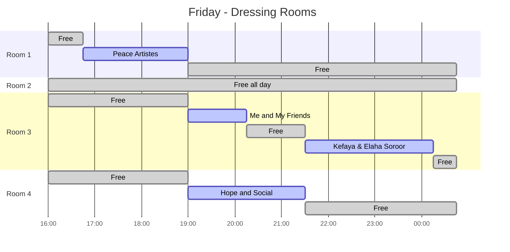
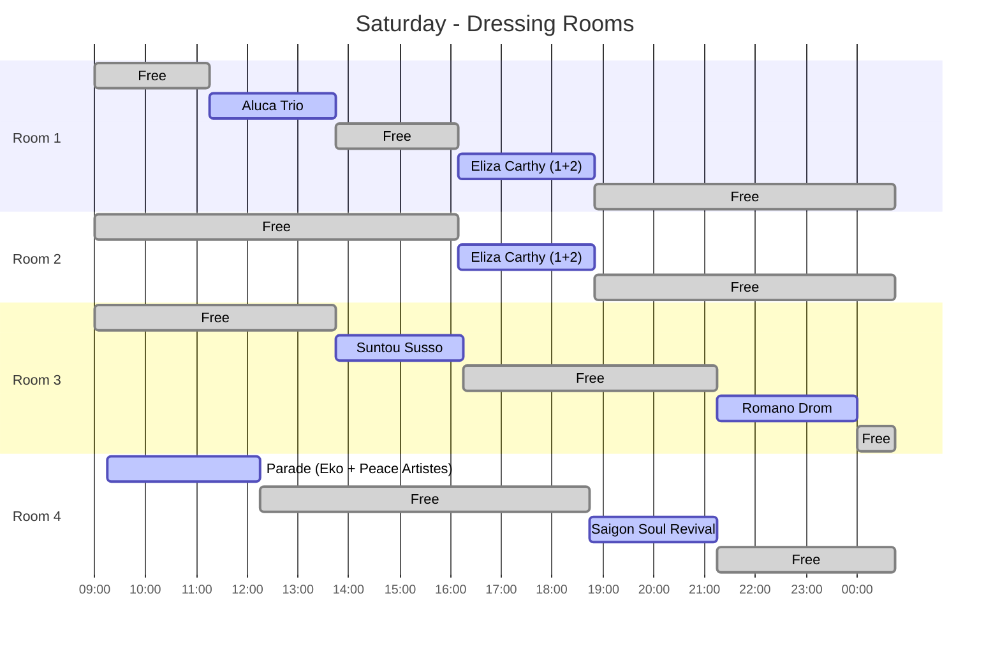
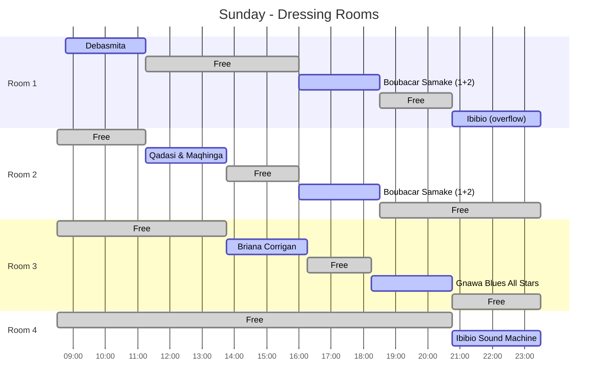

# Musicport 2026 - Dressing Room Gantt

__ !! DO NOT SHARE THIS WITH PATRONS !! __

Derived from the dressing-room allocation in [Musicport26.md](./Musicport26.md). Bookings include the 45 min before / after buffer. Green (`done`) bars are **free windows** that could be offered to other stages; blue/active bars are booked. Allow at least 15 min to reset between bookings. Dates in the charts are placeholders for ordering only (Fri 16th, Sat 17th, Sun 18th).

Provisional bookings: Peace Artistes parade (Sat Room 4, Eko team size unknown), Gnawa Blues All Stars (headcount estimated).

## Friday

## Saturday

## Sunday

## Free windows summary

Windows shorter than ~30 min are omitted.

| Day | Room 1 | Room 2 | Room 3 | Room 4 |
|---|---|---|---|---|
| Fri | 1900 - close | All day | Until 2130 | Until 1900, 2130 - close |
| Sat | 0900-1115, 1345-1610, 1850 - close | 0900-1610, 1850 - close | 0900-1345, 1615-2115 | 1215-1845, 2115 - close |
| Sun | 1115-1600, 1830-2045 | 0830-1115, 1345-1600, 1830 - end | 0830-1345, 1615-1815, 2045 - end | 0830-2045 |

Best opportunities to offer space: Room 2 on Friday (free all day) and Saturday outside 1610-1850, Room 4 on Saturday afternoon (1215-1845) and all Sunday until 2045.
